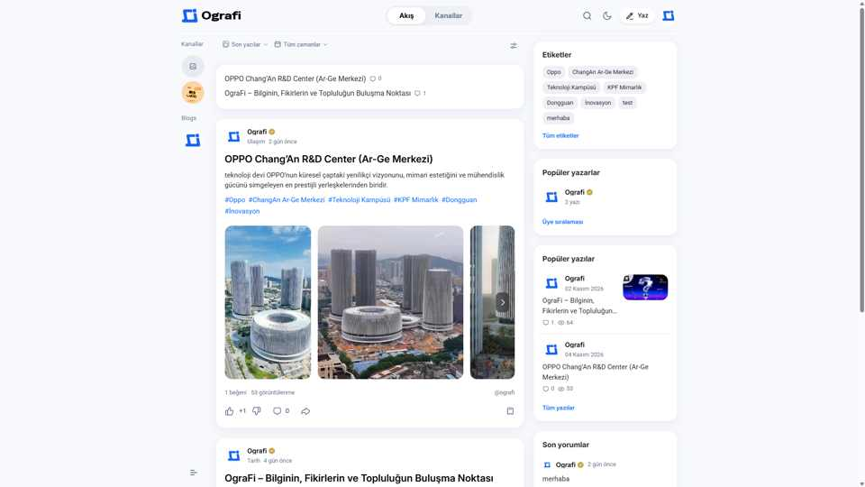
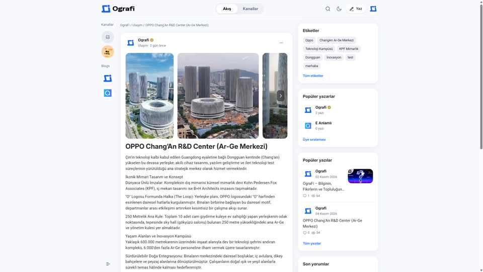
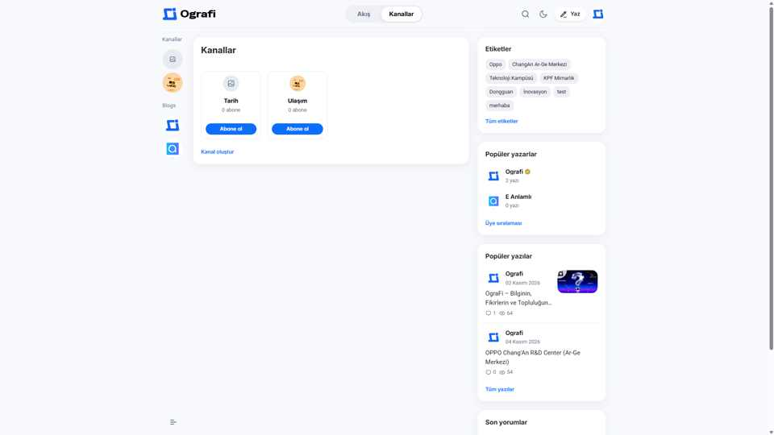
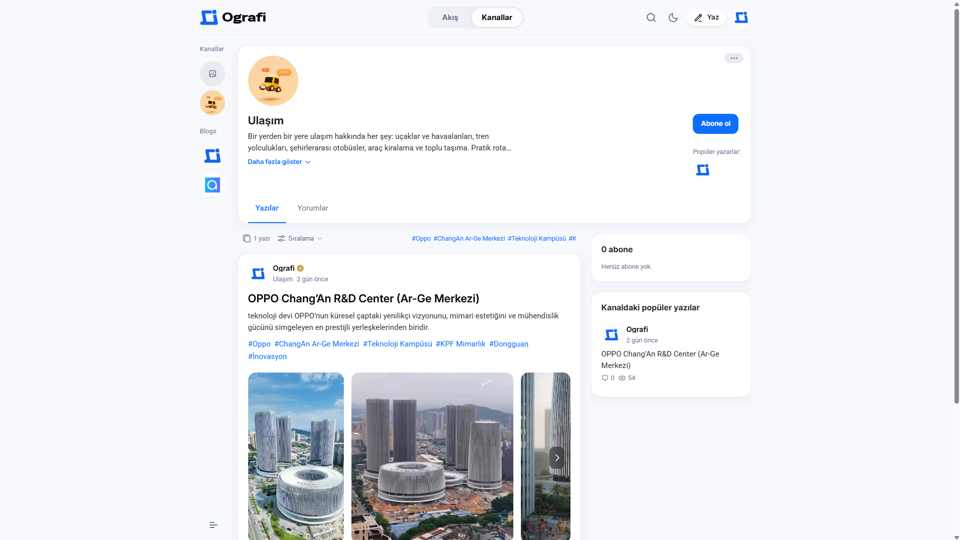

# OgraFi

OgraFi, kullanıcıların içerik yayımlayabildiği, farklı kanallarda topluluklar oluşturabildiği ve diğer üyelerle etkileşim kurabildiği Laravel tabanlı bir içerik ve topluluk platformudur.

## Ekran görüntüleri

### Ana akış


### Yazı ayrıntı sayfası


### Kanallar


### Kanal ayrıntı sayfası


## Teknoloji altyapısı

- Laravel 12
- Filament 5
- Blade, Tailwind CSS, Vite ve JavaScript
- MySQL/MariaDB veya SQLite

## Kurulum

```bash
git clone https://github.com/Ograficom/topluluk2.git
cd topluluk2
composer install
npm install
cp .env.example .env
php artisan key:generate
```

Veritabanı bağlantısını `.env` dosyasında yapılandırdıktan sonra:

```bash
php artisan migrate --seed
php artisan storage:link
npm run build
php artisan serve
```

Uygulama `http://127.0.0.1:8000` adresinde, yönetim paneli `/admin` yolunda açılır.

## Testler

```bash
php artisan test
```
